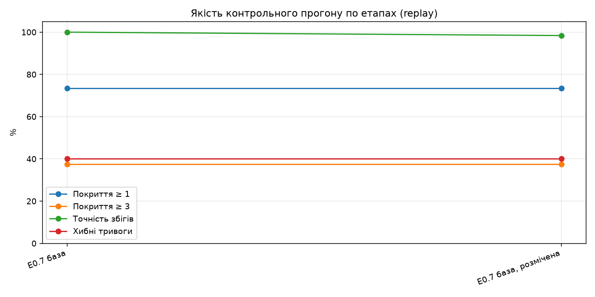

# Метрики якості контрольного прогону

Згенеровано `eval/quality_report.py`. Визначення метрик: `PLAN/DIPLOMA_NOTES.md`, розділ «Метрики якості». Порівняння між етапами лише за рядками `replay`; `live` показує поточний стан ринку.

## Етапи

| Етап | Режим | Дата | SHA | Покриття ≥1 | Покриття ≥3 | Точність (лише same) | Точність лише людські / без позначок | Розмічено | Recall (розмічені) | Хибні тривоги | Частка | Знахідки док. | Вартість/тендер | Час/тендер | Помилки LLM | Нестабільність |
| --- | --- | --- | --- | --- | --- | --- | --- | --- | --- | --- | --- | --- | --- | --- | --- | --- |
| E0.7 база | live | 2026-11-27 | 7b28aee | 73 % | 38 % | 100 % (47 %) | н/д | 12 % | 94 % | 4/10 | 40 % | 54 | $0.0034 | 58.8 с | 0 % | н/д |
| E0.7 база | replay/replay | 2026-11-27 | 7b28aee | 73 % | 38 % | 100 % (47 %) | н/д | 12 % | 94 % | 4/10 | 40 % | 54 | $0.0034 | н/д | 0 % | 0 % |
| E0.7 база, розмічена | replay/replay | 2026-11-28 | 5da3596 | 73 % | 38 % | 98 % (56 %) | 97 % / 97 % | 100 % | 99 % | 4/10 | 40 % | 57 | $0.0035 | н/д | 0 % | н/д |

## Останній рядок `replay`: E0.7 база, розмічена (2026-11-28, 5da3596)

| Тендер | Позицій | Покриття ≥1 | Покриття ≥3 | Прийнято збігів | Розмічено | Правильних | Тривога | Клас | Вартість | Час | Помилки |
| --- | --- | --- | --- | --- | --- | --- | --- | --- | --- | --- | --- |
| C01 | 4 | 100 % | 100 % | 18 | 18 | 18 | medium | unsupported | $0.0033 | н/д | 0 |
| C02 | 3 | 67 % | 67 % | 6 | 6 | 6 | high | supported | $0.0026 | н/д | 0 |
| C03 | 11 | 100 % | 55 % | 26 | 26 | 24 | medium | unverified_doc | $0.0060 | н/д | 0 |
| C04 | 2 | 100 % | 100 % | 9 | 9 | 9 | high | supported | $0.0026 | н/д | 0 |
| C05 | 3 | 33 % | 0 % | 2 | 2 | 2 | high | unsupported | $0.0025 | н/д | 0 |
| C06 | 14 | 64 % | 14 % | 17 | 17 | 17 | high | supported | $0.0047 | н/д | 0 |
| C07 | 11 | 45 % | 0 % | 6 | 6 | 6 | high | unsupported | $0.0042 | н/д | 0 |
| C08 | 5 | 80 % | 80 % | 18 | 18 | 18 | high | supported | $0.0032 | н/д | 0 |
| C09 | 8 | 100 % | 50 % | 20 | 20 | 20 | high | supported | $0.0037 | н/д | 0 |
| C10 | 3 | 33 % | 0 % | 2 | 2 | 2 | high | unsupported | $0.0020 | н/д | 0 |

C10, очікувана поведінка (бланки підприємства без збігів, для «Посвідчення про перевірку знань» аналоги допускаються): **виконано** (порушені позиції: немає; прийнятих збігів без розмітки: 0).

## Останній рядок `live`: E0.7 база (2026-11-27, 7b28aee)

| Тендер | Позицій | Покриття ≥1 | Покриття ≥3 | Прийнято збігів | Розмічено | Правильних | Тривога | Клас | Вартість | Час | Помилки |
| --- | --- | --- | --- | --- | --- | --- | --- | --- | --- | --- | --- |
| C01 | 4 | 100 % | 100 % | 18 | 1 | 1 | medium | unsupported | $0.0033 | 26.8 с | 0 |
| C02 | 3 | 67 % | 67 % | 6 | 0 | 0 | high | supported | $0.0026 | 6.3 с | 0 |
| C03 | 11 | 100 % | 55 % | 26 | 4 | 4 | medium | unverified_doc | $0.0060 | 94.8 с | 0 |
| C04 | 2 | 100 % | 100 % | 9 | 2 | 2 | high | supported | $0.0026 | 10.7 с | 0 |
| C05 | 3 | 33 % | 0 % | 2 | 0 | 0 | high | unsupported | $0.0023 | 29.8 с | 0 |
| C06 | 14 | 64 % | 14 % | 17 | 2 | 2 | high | supported | $0.0047 | 139.8 с | 0 |
| C07 | 11 | 45 % | 0 % | 6 | 2 | 2 | high | unsupported | $0.0042 | 137.5 с | 0 |
| C08 | 5 | 80 % | 80 % | 18 | 0 | 0 | high | supported | $0.0032 | 36.3 с | 0 |
| C09 | 8 | 100 % | 50 % | 20 | 2 | 2 | high | supported | $0.0037 | 69.2 с | 0 |
| C10 | 3 | 33 % | 0 % | 2 | 2 | 2 | high | unsupported | $0.0020 | 37.0 с | 0 |

C10, очікувана поведінка (немає релевантних збігів): **не виконано** (прийнято збігів: 2, з них хибних за розміткою: 0, без розмітки: 0).

